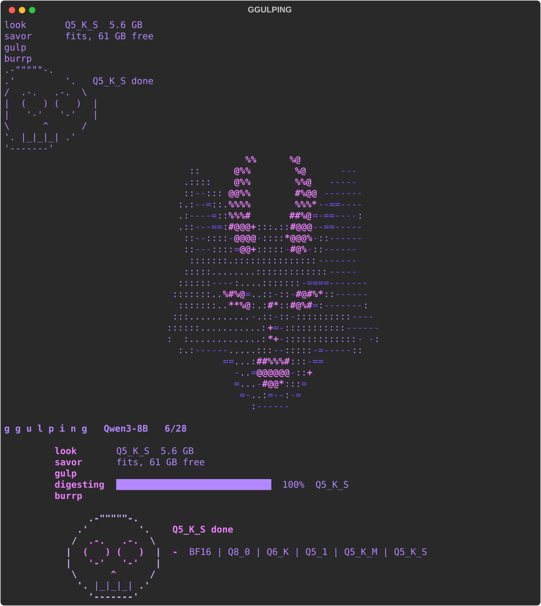

# GGULPING

Give it a model. It makes every GGUF and puts them on Hugging Face.

## How to use it

1. Make a RunPod template with the image `ghcr.io/kibafyi/ggulping:latest`, a volume at `/workspace`, and TCP port `22`.
2. Start a pod and connect with SSH.
3. Answer the questions.
4. Wait. Your GGUFs show up at `huggingface.co/<you>/<name>-GGUF`.

## Modes

- **Smart storage:** uploads when the disk is full, then keeps going. Needs about 2× the model's size.
- **Dump:** makes everything, then uploads it all. Needs about 8× the model's size.

Type `cmd-exit` to leave. Type `ggulp` to come back.

More settings: [.env.example](.env.example)
