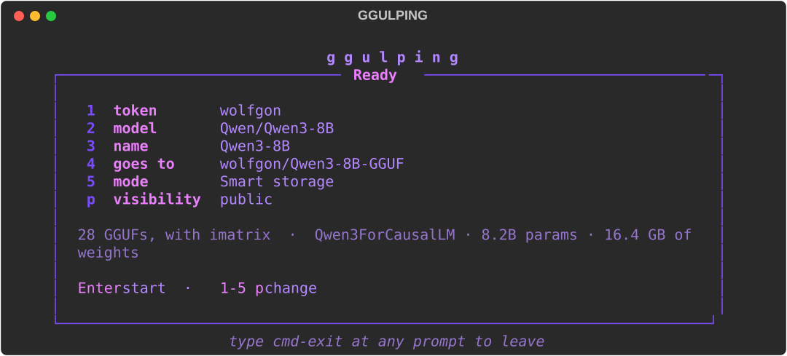

# GGULPING

Give it a model. It makes every [llama.cpp](https://github.com/ggml-org/llama.cpp) GGUF of it
and uploads them all to Hugging Face as `<you>/<name>-GGUF`.

## What you need

- A GPU server, like a [RunPod](https://runpod.io) pod. Without a GPU it still works, but the
  tiniest quants (IQ1, IQ2, IQ3_XXS, Q2_K_S) get skipped.
- A Hugging Face token with **write** access ([get one here](https://huggingface.co/settings/tokens))
- Disk space:
  - **Smart storage** mode: about 2× the model's size
  - **Dump** mode: about 8× the model's size

## Start it on RunPod

1. Go to **Templates** → **New Template**.
2. Set **Container Image** to `ghcr.io/kibafyi/ggulping:latest`
3. Set **Container Disk** to 30 GB.
4. Set **Volume Disk** big enough (see above), mounted at `/workspace`.
5. Add **TCP port** `22`.
6. Save, then start a pod with this template.
7. Connect with SSH. The setup screen opens by itself.

## The setup screen

1. Your Hugging Face token
2. The model: a Hugging Face link, a model folder on the pod, or a `.gguf`
3. A name. The repo becomes `<name>-GGUF`
4. Where it goes (only asked if you're in an org)
5. Smart storage or dump

Then press **Enter** to start. Press **p** first if you want the repo public.

## The two modes

**Smart storage.** It checks the disk before every quant. When the next one won't fit, it
uploads everything made so far, deletes it, and keeps going. Use this one unless you have a lot
of space.

**Dump.** It makes every quant first, then uploads them all at once. Nothing gets deleted. If the
disk fills up, it stops and uploads what's done.

## What it looks like

Every quant goes **look**, **savor**, **gulp**, **digesting**, **burrp**. Each finished quant
becomes a skull in the pile. When the disk is full it says *HMMMPH... I'm full. Need to rest and
absorb all this.*, uploads the pile to Hugging Face, rests, and goes on to the next one.

Before the first quant it downloads the model, turns it into one big BF16 GGUF, and (with a GPU)
makes an importance matrix with [bartowski's calibration data](https://gist.github.com/bartowski1182/82ae9b520227f57d79ba04add13d0d0d).
The model's README is copied over exactly as it is at the end.

Files over 45 GB are cut into pieces, because Hugging Face doesn't take bigger files.
llama.cpp loads the pieces on its own.

If the pod stops halfway, start it again with the same name. Anything already uploaded is skipped.

Type `cmd-exit` at any time to leave the setup screen. Type `ggulp` to bring it back.

## Start without the setup screen (optional)

Add these to your RunPod template and it starts by itself when the pod turns on:

| Name | Example |
|---|---|
| `GGULP_MODEL` | `Qwen/Qwen3-8B` |
| `HF_TOKEN` | your Hugging Face token |
| `GGULP_NAME` | `Qwen3-8B` (leave it out to use the model's name) |
| `GGULP_MODE` | `smart` or `dump` |
| `GGULP_PRIVATE` | `0` for a public repo |

More settings (only some quants, a Discord ping, a disk limit, your own calibration text) are in
[.env.example](.env.example). They also work with the setup screen.

## Handy commands

| Command | What it does |
|---|---|
| `ggulp` | Open the setup screen |
| `ggulp logs -f` | Watch the log |
| `ggulp attach` | Go back to one that's running |
| `ggulp menu` | List every quant this llama.cpp can make |

## Updating the image

Change the code in this repo and push it. GitHub rebuilds the image for free.

To move to the newest llama.cpp: **Actions** → **build image** → **Run workflow**, type `newest`, and run it.
