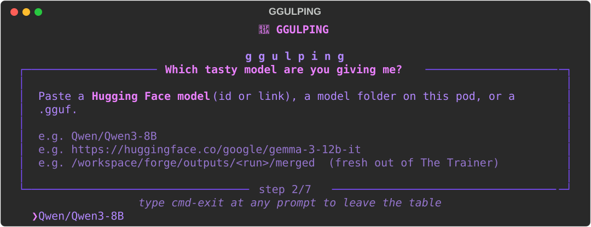

# GGULPING

Give it a model. It makes every [llama.cpp](https://github.com/ggml-org/llama.cpp) GGUF of it
and uploads them all to Hugging Face as `<you>/<name>-GGUF`.

## What you need

- A GPU server, like a [RunPod](https://runpod.io) pod. Without a GPU it still works, but the
  tiniest quants (IQ1, IQ2, IQ3_XXS, Q2_K_S) get skipped.
- A Hugging Face token with **write** access ([get one here](https://huggingface.co/settings/tokens))
- Disk space:
  - **Smart storage** mode: about 2× the model's size
  - **Dump** mode: about 8× the model's size for every quant
- A Discord webhook if you want a ping when it's done (optional)

## Start it on RunPod

1. Go to **Templates** → **New Template**.
2. Set **Container Image** to `ghcr.io/kibafyi/ggulping:latest`
3. Set **Container Disk** to 30 GB.
4. Set **Volume Disk** big enough (see above), mounted at `/workspace`.
5. Add **TCP port** `22`.
6. Save, then start a pod with this template.
7. Connect with SSH. The setup screen opens by itself.

## The setup screen

It asks one question at a time:

1. Your Hugging Face token
2. The model: a Hugging Face link, a model folder on the pod, or a `.gguf`
3. A name. The repo becomes `<you>/<name>-GGUF` and the files `<name>-Q4_K_M.gguf`, `<name>-Q8_0.gguf`, …
4. Where to upload: your account or one of your orgs
5. The menu: every quant, the snack plate, or pick your own
6. The mode: smart storage or dump
7. Your Discord webhook (optional)

Then you get a summary. Press **Enter** to start, or type a number to change that answer.

## The two modes

**Smart storage.** Before making each quant, it checks if it fits on the disk. If it doesn't,
it uploads the finished ones and deletes them to make room. You can also tell it how many GB
it's allowed to use, which helps on volumes you pay for per GB. Use this one unless you have a
lot of space.

**Dump.** Makes every quant first, then uploads them all at once. Nothing gets deleted. If the
disk fills up, it stops making quants and uploads what's done. Only use it if you have plenty
of space.

## What happens

1. The model downloads.
2. It becomes one big BF16 GGUF, and the download is deleted.
3. If there's a GPU, it runs the model on some text first. This "importance matrix" makes the
   small quants better, and the tiniest ones can't be made without it.
4. Every quant gets made, biggest first, and uploaded.
5. The model's README is copied over exactly as it is.
6. Discord gets a message.
7. You're back at the start screen.

Files over 45 GB are cut into pieces, because Hugging Face doesn't take bigger files.
llama.cpp loads the pieces on its own.

If the pod stops halfway, start it again with the same name. Anything already uploaded is skipped.

Type `cmd-exit` at any time to leave the setup screen. Type `ggulp` to bring it back.

## The menu

| Menu | What's on it |
|---|---|
| The full buffet | BF16, Q8_0, Q6_K, Q5_1, Q5_K_M, Q5_K_S, Q5_0, Q4_1, Q4_K_M, Q4_K_S, IQ4_NL, Q4_0, IQ4_XS, Q3_K_L, Q3_K_M, IQ3_M, Q3_K_S, IQ3_S, IQ3_XS, IQ3_XXS, Q2_K, Q2_K_S, IQ2_M, IQ2_S, IQ2_XS, IQ2_XXS, IQ1_M, IQ1_S (+ MXFP4_MOE for MoE models) |
| The snack plate | Q8_0, Q6_K, Q5_K_M, Q4_K_M, IQ4_XS, Q3_K_M, Q2_K |
| À la carte | whatever you type |

## Start without the setup screen (optional)

Add these to your RunPod template and it starts by itself when the pod turns on:

| Name | Example |
|---|---|
| `GGULP_MODEL` | `Qwen/Qwen3-8B` |
| `HF_TOKEN` | your Hugging Face token |
| `GGULP_NAME` | `Qwen3-8B` (leave it out to use the model's name) |
| `GGULP_NAMESPACE` | your account or org (leave it out for your account) |
| `GGULP_MODE` | `smart` or `dump` |
| `GGULP_QUANTS` | `buffet`, `snack`, or a list like `Q8_0,Q4_K_M` |
| `GGULP_PRIVATE` | `1` for a private repo, `0` for public |
| `GGULP_DISCORD_WEBHOOK` | your Discord webhook |

All other settings are listed in [.env.example](.env.example).

## Handy commands

| Command | What it does |
|---|---|
| `ggulp` | Open the setup screen |
| `ggulp logs -f` | Watch the log |
| `ggulp attach` | Go back to one that's running |
| `ggulp menu` | List every quant this llama.cpp can make |

## Updating the image

Change the code in this repo and push it. GitHub rebuilds the image for free.

To move to the newest llama.cpp: **Actions** → **build image** → **Run workflow**, type `newest`, and run it.
